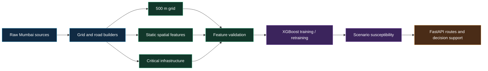

# Data sources and provenance

This is the authoritative short inventory for the active Mumbai pipeline.
Paths are relative to the repository root.

## Study area and coordinate systems

- Jurisdiction: Brihanmumbai Municipal Corporation (BMC / MCGM), Mumbai,
  Maharashtra.
- Working bounds: approximately `18.89-19.30 N`, `72.75-73.02 E`.
- Metric processing CRS: `EPSG:32643`.
- Display and GeoJSON CRS: `EPSG:4326`.

The generated provenance manifest is
[`backend/data/mumbai/mumbai_provenance_manifest.json`](../backend/data/mumbai/mumbai_provenance_manifest.json).

## Dataset-to-model flow



The road graph is consumed by routing and network analysis alongside the
susceptibility grid; it is not a training label.

## Active assets

| Asset | Path | Verified fact |
| --- | --- | --- |
| 500 m grid | `data/processed/grids/mumbai_grid_500m.geojson` | Manifest records 1,767 cells. |
| Static features | `data/processed/features/mumbai_static_spatial_features.parquet` | Manifest records 25 model feature columns. |
| Critical infrastructure | `data/processed/vectors/mumbai_critical_infrastructure.parquet` | Manifest records 537 facilities. |
| XGBoost model | `models/trained/mumbai_xgboost_baseline.json` | Prototype susceptibility model. |
| Evaluation metadata | `models/trained/mumbai_model_evaluation.json` | Label source, feature names, and evaluation metadata. |
| OSM road cache | `data/processed/roads/mumbai_drive_network.json.gz` | Generated by the Overpass road builder; see its `.meta.json`. |

Raw downloads, when present, are under `backend/data/mumbai/raw/`. The exact
files available depend on which pipeline steps have been run.

## Labels, features, and model interpretation

- The training target is binary proximity to BMC chronic waterlogging hotspot
  coordinates within 750 m.
- The transparent rule-based susceptibility index is separate from the ML
  target and is blended during inference.
- Evaluation metrics describe agreement with the hotspot-proximity proxy under
  stratified cross-validation. No independent chronological flood-event labels
  are available for this prototype.
- Inference rainfall predictors are deterministic scenario baselines. The
  default code does not connect to live IMD or BMC AWS observations.
- `waterDepth` is unmeasured and remains `null`.
- `dist_to_buckingham_canal_m` is a legacy schema name for the Mithi/Mahim
  Creek corridor distance in the Mumbai feature set.

## Road network

The builder in
[`scripts/build_mumbai_road_network.py`](../scripts/build_mumbai_road_network.py)
downloads OpenStreetMap highway ways through Overpass. The default filter is
arterial/collector classes (`motorway` through `tertiary`, including links);
`--full` additionally includes residential, unclassified, and living-street
ways.

The cache stores consecutive OSM node pairs and real geometry, with no
synthetic chords. Its metadata records the source, license, bounds, CRS, and
counts for the build that produced it. Risk-aware routing samples the model
susceptibility grid along each edge; unknown coverage uses the configured
conservative default and is reported in the route response. This is not live
traffic or a verified road-closure feed.

## Reproducibility

```powershell
python scripts/build_mumbai_pipeline.py
python scripts/build_mumbai_road_network.py
python scripts/retrain_mumbai_model.py
```

The first two commands can require network access. Preserve the generated
metadata alongside rebuilt assets when comparing results. See
[mumbai_data_sources.md](mumbai_data_sources.md) for the source catalogue and
[README.md](../README.md) for the complete setup flow.
